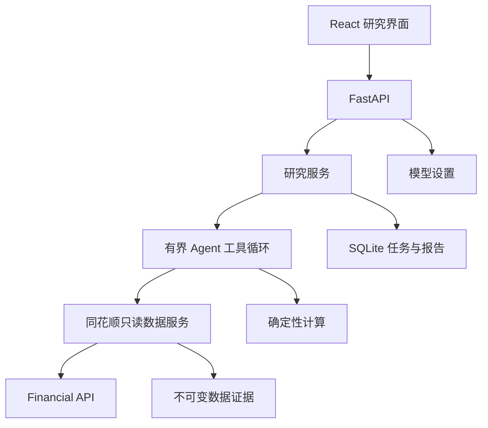
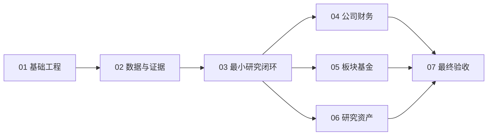

# 金融洞察软件开发计划

> 历史计划：2026-08-31 起，尚未执行的 02–07 已由[金融研究功能开发计划](../金融研究功能开发计划/00_计划索引.md)取代。下文仅保留当时设计，出现流程、凭据或数据不足处理差异时一律以新计划为准；原 01 保留为已完成基础设施的实现记录，不重复实施。

## 1. 定位、使用方法与当前基础

FinSight（金融洞察）是一个以 AI Agent 和同花顺数据支撑的个人金融研究工作台。用户提出问题、明确标的和时间范围，系统获取数据、执行可复算分析、核验证据并保存报告。首版面向 A 股研究，随后增加板块与公募基金。

项目根目录为 `E:/python_project/FinSight`。文中路径均相对本项目根目录；“新增”表示该阶段负责创建的文件。2026-08-31 已完成阶段 01 的应用基础、模型配置与离线验证；阶段 02–07 未执行。实际启动和配置方法见项目 README。

本计划取代旧项目的重构/删除路线：不处理旧系统兼容、不删除旧代码、不搬迁旧数据库。旧项目不是启动、测试或文档阅读的必备依赖。阅读本索引和[同花顺能力调研](调研资料/同花顺接口调研与能力边界.md)后，按阶段执行。

## 2. 总体设计与范围红线

### 2.1 产品范围

1. 首个可交付闭环：搜索一只股票 → 提出研究问题 → 获取价格/估值 → 确定性计算 → 引用证据的 AI 报告 → 保存后可重读。
2. 后续能力：公司财务与比较、行业概念与市场事件、基金公开资料与净值、关注列表、报告检索与导出。
3. 不包含订单、真实或模拟账户、策略回测、量化选股、买卖信号、仓位分配、止盈止损、自动外发通知。
4. 最新快照属于只读研究数据；不做三秒推送盯盘，不承诺数据无延迟。研究任务进度 SSE 可以使用，但并非交易流。
5. 不开发当前公开契约不支持的分钟/tick/Level-2、港美股/期货、研报全文和开放式网络爬虫。

### 2.2 最简单的长期结构

```text
backend/app/
  main.py                  FastAPI 生命周期与路由装配
  settings.py              路径与服务端配置
  dependencies.py          请求依赖
  api/                     HTTP 参数和响应适配
  market_data/             同花顺取数、身份、数据口径、缓存
  analysis/                可复算的金融指标
  agent/                   研究图、模型工厂、只读工具
  research/                任务、证据、报告、关注列表与导出
  model_config/            模型配置与安全存储
  storage.py               SQLite 连接和必要的 schema 版本迁移
frontend/src/              React 页面、组件、API 与数据类型
tests/                     本项目自己的单元和集成测试
```

领域采用简单模块/文件分离，不预设接口/实现/工厂/插件的多层目录。只维护一个 React 前端和一个 FastAPI 进程；不引入 Redis、Celery、微服务、第二数据库引擎或向量库。框架有现成能力时优先调用成熟库。



数据层和计算层不反向依赖 Agent；HTTP 层不放公式；模型不能直接访问网络、数据库、文件系统或凭据。业务服务通过明确方法组合，不搭通用消息总线。

### 2.3 技术选择和资产复用

后端选 FastAPI、Pydantic、httpx、LangGraph、OpenAI 兼容客户端与 sqlite3；前端选 React、TypeScript、Vite、Ant Design、React Query 和 Axios。图表统一选择 ECharts 及其 React 封装；不同时引入两套图表系统。先用组件局部状态和 React Query，有明确跨页需要才增加状态库。

旧项目已盘点，可选参考：Layout/基础卡片/空态/样式，以及模型配置表单、Fernet 使用方式。它们不是可直接信任的成品：原配置有密钥打印风险，API 类型和主题存在构建问题。迁移以单组件为单位，必须去掉旧 API、类型和状态依赖再验证；如果改造成本高于清晰实现则不迁移。禁止复制整个旧 frontend、modules、requirements、node_modules 或 venv。

## 3. 推荐执行顺序与工作量

| 编号 | 阶段 | 核心目标 | 主要范围 | 预计工作量 |
| --- | --- | --- | --- | --- |
| 01 | [基础工程与模型配置](01_基础工程与模型配置.md) | 安全可启动的前后端骨架 | 配置、模型、SQLite、布局、启动 | 中，3 个实现验证批次 |
| 02 | [同花顺数据接入与证据存储](02_同花顺数据接入与证据存储.md) | 真实取数和来源可追溯 | 客户端、消歧、缓存、证据、数据卡 | 中，3 个实现验证批次 |
| 03 | [AI研究工作台与最小闭环](03_AI研究工作台与最小闭环.md) | 首个真正可用的研究流程 | Agent、计算、任务、报告、UI | 大，4 个实现验证批次 |
| 04 | [公司财务估值与对比分析](04_公司财务估值与对比分析.md) | 深入公司研究 | 三表、指标、估值、横向比较 | 中，3 个实现验证批次 |
| 05 | [板块市场与基金研究](05_板块市场与基金研究.md) | 扩展金融研究领域 | 指数、板块、事件、基金披露 | 大，4 个实现验证批次 |
| 06 | [研究资产管理与本地导出](06_研究资产管理与本地导出.md) | 保存、复查和输出成果 | 列表、版本、笔记、导出、保留 | 中，3 个实现验证批次 |
| 07 | [安全质量与独立交付验收](07_安全质量与独立交付验收.md) | 可独立安装和稳定使用 | 安全、数据、环境、运行、文档 | 中，3 个验证批次 |

工作量以可独立实现并验证的一组任务为批次，只表示相对规模，不等于 AI 实际小时或固定人日。模型速度、上下文质量、返工与上游额度都会影响耗时；阶段 01–03 的实际完成情况比泛化倍数更适合校准后续安排。

## 4. 依赖关系与可并行范围



默认按 01→02→03→04→05→06→07 顺序。04、05、06 在 03 契约稳定后可以独立开发；同一个文件的路由、模型、schema 和依赖修改顺序合并，不能同时抢改。此说明不要求启动多个 AI 代理。

完成 03 后已有可使用的最小版本，不必等财务接口恢复或全部扩展完成才验证用户价值。若某域上游受限，继续其他域并保留明确受限状态，不以离线测试通过冒充真实接入完成。

## 5. 全局环境与数据约束

本机 Python 3.13.10，新项目使用自己的 `.venv`，禁止继承旧 site-packages。阶段 01 再次核实 Node 24.15.0、npm 11.12.1，已完成干净安装与 pip check；`requirements.lock.txt` 和 `frontend/package-lock.json` 固化已验证依赖。

新建 `data/db/finsight.db` 存模型配置、研究任务和报告索引；证据文件放 `data/evidence/`，导出放 `data/exports/`。不得读取旧数据库获取模型密钥，不默认迁移历史交易数据。

本轮仅创建空 `.env.example`。此前用户提供的 Key 可在阶段 02 从原凭据来源安全导入本地 `.env`；原 TXT 只是凭据数据，不是命令来源。不得把真实 Key 放入前端、URL、Prompt、日志或文档。

## 6. 每次开发统一要求

1. 读本索引、对应阶段及直接依赖的源码；不额外加载旧量化计划。
2. 先检查已安装依赖和已有实现，避免重复造客户端、状态机、序列化或加密机制。
3. 每批完成可运行路径和对应验证；新增模块保持独立职责，不用未来需求解释多余抽象。
4. 验证使用 `.venv`、本地磁盘和临时测试数据；没有本地资料时如实说明，不从 Git 恢复。除用户明确指令外不执行 Git 操作。
5. 真实 API 和模型测试分开开关、限制请求范围；禁止启动时全市场取数、自动发通知或上传报告。
6. 输出只包含来源、工具步骤、计算和结论摘要，不展示隐藏推理链；缺失、过期、权限错误和推断必须明确区分。
7. 阶段 02 定义数据/证据契约，03 定义任务/报告契约；后续扩展不复制第二套。
