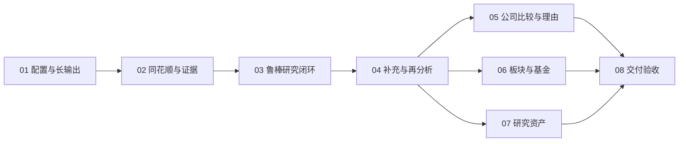

# 金融研究功能开发计划

## 1. 定位与使用方法

### 1.1 本轮目标

在已运行的 FinSight 基础上建设个人金融研究工作台：公司财务体检、同行比较、投资理由跟踪、板块相对表现、基金持仓穿透与相关市场复盘。用户提出问题后，系统取数、计算、解释、列明缺口；用户可补资料、配置其他数据源或保留当前结论，再自主启动新一版分析。

本计划根据 2026-08-31 实际代码与官方资料制定，取代 `docs/金融洞察软件开发计划/` 中尚未执行的 02–07 功能路线；旧 01 作为基础设施实现记录保留。不要重做已完成的工程，不读取旧项目或历史凭据文件。这里的任务、版本、状态均指产品业务对象，不建立计划执行指针、回执或恢复管理机制。

当前交付形态仍是 Windows 本机应用，每位使用者在自己的安装实例配置自己的 API Key。公网托管是不同的安全边界，不能将当前回环端口开放就称为多用户上线，具体边界见 08。

### 1.2 已有代码事实

项目根目录：`E:/python_project/FinSight`。以下路径均相对此目录。

| 已存在的位置 | 当前能力与本轮处理 |
| --- | --- |
| `backend/app/main.py`、`settings.py`、`security.py` | FastAPI 生命周期、回环地址、本机会话；继续使用，按路由增加上传限制 |
| `backend/app/storage.py` | SQLite schema v2，唯一迁移入口；新增业务表，不重建数据库 |
| `backend/app/model_config/` | 三家官方模型、Fernet、只写密钥；扩展统一配置页，复用加密基础 |
| `backend/app/agent/model_factory.py`、`provider_requests.py` | 单轮试用、协议探针和部分流式合并；尚无业务 Agent |
| `frontend/src/pages/Settings/`、`api/client.ts` | 模型配置、试用与 130 秒 Axios 超时；研究任务改为异步任务与事件流 |
| `启动FinSight.bat`、`scripts/start_all.ps1` | 安全重启服务、健康检查、默认浏览器；保持可运行 |

当前 `max_tokens` 默认 2048/8192、上限 32768；模型总超时最多 120 秒；回复限制 262144 字符，工具参数限制 16384 字符；写请求最多 32768 字节。不能仅改前端输入框就宣称支持长输出。

已安装 FastAPI、Pydantic 2.13.3、httpx 0.28.1、OpenAI SDK 2.32.0、LangGraph 1.1.10、cryptography；前端 React 19、Ant Design 6、React Query、Axios、Vitest。没有金融适配器、报告、附件解析器或图表库，新增文件在各阶段明确列出。

## 2. 全局要求与边界

### 2.1 用户五项要求的落点

| 要求 | 必须交付的行为 | 主阶段 |
| --- | --- | --- |
| 缺数据仍分析 | 按维度继续；缺项、影响、可补方式随报告返回；零业务数据也给研究框架及取证清单，不编造公司事实；补充后用户主动重分析 | 03、04、05 |
| JSON 鲁棒解析 | 原生结构化输出、完整流式聚合、严格 JSON/Pydantic/证据校验、有限修复、局部保留；工具参数不靠猜测修复执行 | 03 |
| 输出上限最大 | 默认采用模型、模式、地域与协议实际最大值；同步解决超时、上下文、字节限额、截断检测和续写 | 01、03 |
| 外部数据补充 | 同花顺主源；博查/Tavily 搜索；Tushare 可选结构化补充；原文与用户资料独立留源，冲突不混算 | 02、04 |
| 用户自己的 API | 同一个设置入口展示全部已接入 API、独立 Key、能力状态和外发范围；没有开发者公共 Key 或隐藏回退 | 01、04、08 |

### 2.2 研究与安全红线

1. 不做订单、账户、模拟交易、策略回测、量化选股、仓位分配、自动外发通知；比较组由用户明确选定。历史表现不等于未来收益。
2. 数据不足不是任务失败。安全拒绝、无有效模型、供应商过滤和连接完全不可用是独立问题，不能承诺绕过它们；保留可读数据与已完成内容，明确原因。
3. 数值由确定性程序计算，LLM 负责解释、组织与提出可检验假设。推断、用户假设、来源事实、计算结果分开。
4. 报告期、披露日、市场日期、抓取时间、单位、复权和来源随证据传递。空值不补零；财务字段、搜索摘要、模型补全不能相互冒充。
5. Key 不进前端持久化、Prompt、URL、日志、报告、导出包或他人的会话。后台无凭据时不得借用环境里的开发者密钥。
6. 用户在任务开始时选择数据源、允许的搜索/资料外发和调用预算，此授权在该任务内有效，不逐次重复弹窗；超范围调用、新增付费源或私有附件外发需用户主动选择。
7. 官网写“规划中”的端点不算已接入；供应商成功响应不代表数据已齐全、获得商用权或模型处理权。

### 2.3 最小长期结构

沿用单 FastAPI、单 React、SQLite 与本地文件。新增 `api_config/` 管金融/搜索服务的凭据和能力；已有 `model_config/` 继续管模型参数，避免把所有服务硬塞进模型表。两者共享一处根密钥管理及同一个设置页面。

`market_data/` 负责结构化取数，`analysis/` 负责计算，`agent/` 负责有限工具流程和输出解析，`research/` 负责任务/证据/报告/补充资料，`web_research/` 负责受限检索和原文。使用固定服务商目录与薄适配器，不做任意插件框架、微服务、消息总线、向量库或第二数据库。

### 2.4 成熟产品参考与采用范围

参考 Koyfin 已有的财务分析页、用户关注列表、相对表现和关注对象资讯组织方式：本项目采用“用户选标的 → 可比数据表/图 → 相关资料”的研究入口，不先搭复杂自由布局系统，也不复制其账户、交易和全市场筛选范围。[Koyfin 官方功能说明](https://www.koyfin.com/help/topic/functionality/)

参考 AlphaSense Deep Research 的结论逐项引用与点击回到来源的审阅方式：本项目让事实、计算和解释都能回看证据，再叠加本次明确要求的缺口面板、用户补充和版本再分析。这只是交互模式参考，不等于拥有其专有内容库、数据授权或同等分析覆盖。[AlphaSense 官方产品说明](https://www.alpha-sense.com/resources/product-articles/introducing-deep-research-in-alphasense/)

## 3. 执行顺序与工作量

| 编号 | 阶段 | 核心目标 | 主要范围 | 相对工作量 |
| --- | --- | --- | --- | --- |
| 01 | [统一API配置与模型输出上限](01_统一API配置与模型输出上限.md) | 用户自带 Key，大输出可配置 | 设置页、密钥、能力目录、请求参数、迁移 | 大，3–4 批 |
| 02 | [同花顺数据证据与基础计算](02_同花顺数据证据与基础计算.md) | 可用数据有出处 | 消歧、价格/估值/三表、缺口、证据、基础计算 | 大，3–4 批 |
| 03 | [鲁棒AI研究与结构化输出](03_鲁棒AI研究与结构化输出.md) | 首个缺数据仍可用的研究闭环 | Agent、JSON、长输出、任务、报告、初版再分析 | 大，4–5 批 |
| 04 | [补充数据源与用户资料再分析](04_补充数据源与用户资料再分析.md) | 补齐结构化与解释性证据 | 搜索、Tushare、附件、原文、冲突与用户确认 | 大，4–5 批 |
| 05 | [公司财务同行比较与投资理由跟踪](05_公司财务同行比较与投资理由跟踪.md) | 持续公司研究 | 财务体检、比较、假设、变化解释 | 大，3–4 批 |
| 06 | [板块市场与基金研究](06_板块市场与基金研究.md) | 扩展研究领域 | 相对表现、基金穿透、基金质量、相关复盘 | 大，4–5 批 |
| 07 | [研究资产管理与本地导出](07_研究资产管理与本地导出.md) | 成果长期可读、可撤销 | 检索、版本、笔记、导出、保留策略 | 中，2–3 批 |
| 08 | [安全鲁棒性与自带密钥交付验收](08_安全鲁棒性与自带密钥交付验收.md) | 独立安装和故障验收 | 测试矩阵、真实联调、交付清洁度、上线边界 | 大，3–4 批 |

批次是可独立实现与验证的一组工作，不是承诺的人日。03 完成即可使用基础研究与文字补充；04 丰富证据；05–07 不得拆掉已可运行闭环。

## 4. 依赖关系



默认顺序执行。05、06、07 在 04 的契约稳定后可独立推进，但 `storage.py`、API 路由和报告 schema 的修改须顺序协调；此图不要求启用多代理。每阶段先完成本阶段验收，再进入依赖它的阶段。

## 5. 统一开发与验证要求

### 5.1 环境和命令

使用项目 `.venv/Scripts/python.exe`，不向系统 Python 安装依赖。只在必要阶段增加成熟库并同步 `requirements.txt`、`requirements.lock.txt` 或 `frontend/package.json`、`frontend/package-lock.json`。本轮撰写计划不安装新包。

```powershell
.\.venv\Scripts\python.exe -m pip check
.\scripts\test_backend.ps1
```

在 `frontend/` 中分别执行 `npm run build`、`npm run lint`、`npm run test`。测试基于本地磁盘，临时资料位于 `.cache/`；不执行任何 Git 操作。浏览器验收覆盖 1440px、768px、390px、刷新/重连、无 Key 和部分数据。

### 5.2 阅读与变更要求

先读本索引、目标阶段与直接依赖的代码。每阶段精确区分“已有修改”和“新增文件”；出现依赖阶段文件不存在时先完成该依赖，不能伪称现有实现。数据库版本从当前实际 `user_version` 顺序增加，仅由 `Storage.initialize()` 迁移。

联网验证与离线测试分离，使用虚假密钥与 MockTransport；真实验证只使用当前用户主动配置的 Key，明确单次范围和计费，不访问历史凭据路径。普通启动、健康检查、读取报告不调用外部 API。

### 5.3 前置调研

- [补充数据源调研与选型](调研资料/补充数据源调研与选型.md)：能力、费用模式、凭据、许可和采用结论。
- [模型输出上限与JSON解析依据](调研资料/模型输出上限与JSON解析依据.md)：模型参数、解析库、协议差异与验证边界。
- [同花顺能力与功能边界](调研资料/同花顺能力与功能边界.md)：本轮功能映射和不能假定的字段。

上述资料记录本次官方文档事实与设计判断，价格、授权、模型能力变动时按目标端点重新核验；不把文档样例当成真实投资数据。
